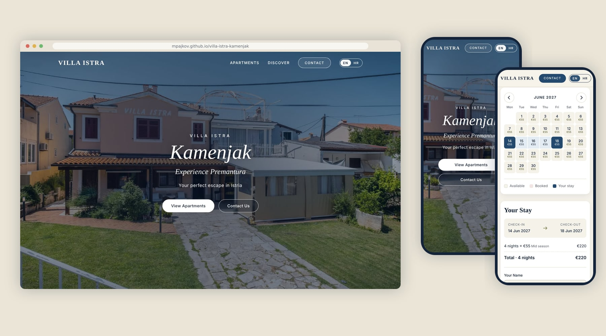

# Villa Istra Kamenjak

**Brza dvojezična (hrvatski / engleski) web stranica za apartmane u Premanturi u Istri**, s galerijama fotografija, kalendarom slobodnih termina, automatskim izračunom cijene i formom za upit.

[**Pogledaj uživo**](https://mpajkov.github.io/villa-istra-kamenjak/) · [English description](README.md) · Izradio [mpajkov](https://github.com/mpajkov)



> Bez frameworka, bez instalacije, bez praćenja i bez kolačića. Čisti HTML, CSS i JavaScript koji vlasnik može mijenjati u bilo kojem uređivaču teksta, a može se besplatno postaviti gotovo bilo gdje.

---

## Što dobiva gost

- **Četiri stranice** (početna, tri apartmana i vrt), svaka s galerijom fotografija koja radi dodirom, mišem i tipkovnicom.
- **Kalendar slobodnih termina** za svaki apartman: gost odabere dolazak i odlazak, vidi cijenu po noći, sezonu i **ukupnu cijenu**, pa pošalje upit. Zauzete noći su precrtane, a minimalni boravak vrijedi po sezonama.
- **Hrvatski ili engleski jednim klikom.** Izbor se pamti, preglednici na hrvatskom otvaraju hrvatsku verziju sami, a linkovi oblika `?lang=en` rade za dijeljenje.
- Stranica koja je **ugodna na svakom ekranu**: mobitel, tablet, laptop i veliki monitori.

## Što dobiva vlasnik

- **Jedna datoteka s postavkama** (`assets/js/config.js`) za cijene, sezone, minimalne boravke i zauzete termine. Ne treba znati programirati.
- Upiti stižu **emailom**, uvijek na engleskom za vlasnika, uz napomenu na kojem je jeziku gost pisao, a "Odgovori" ide izravno gostu. Besplatno za otprilike 250 poruka mjesečno preko [Web3Forms](https://web3forms.com). Dok ključ nije upisan, otvara se gostov email program s pripremljenom porukom pa nijedan upit ne propadne.
- **Zaštita od spama bez CAPTCHA-e** (skriveno polje, provjera vremena i kratka stanka), pa gosti nikad ne moraju klikati semafore.
- **Bez troškova održavanja**: statične datoteke na GitHub Pages, Netlifyju, Cloudflare Pagesu ili običnom hostingu.
- Prilagođeno tražilicama: naslovi i opisi na oba jezika, slika za dijeljenje linka, `sitemap.xml`, `robots.txt` i strukturirani podaci o smještaju.

---

## Provjere kvalitete

Sve navedeno izmjereno je na ovom kodu automatiziranim testovima (Playwright/Chromium). Sam Lighthouse nije se mogao instalirati u okruženju u kojem je stranica građena.

| Područje | Rezultat |
|---|---|
| **Brzina** (simulirani srednji mobitel: procesor 4 puta sporiji, 1,6 Mbit/s, kašnjenje 150 ms) | Prvi prikaz 0,55 do 0,62 s, najveći prikaz 0,55 do 1,1 s, pomak rasporeda 0, vrijeme blokiranja ispod 0,15 s |
| **Veličina** | Početna stranica oko 233 KB, stranice apartmana 160 do 450 KB pri prvom otvaranju (fotografije se učitavaju dok gost listaja) |
| **Prilagodba ekranima** | Nema vodoravnog pomicanja ni sadržaja izvan ekrana pri 320, 375, 768, 1024 i 1440 px, na oba jezika; izgled pregledan na mobitelu, tabletu i računalu |
| **Pristupačnost** | Poveznica "preskoči na sadržaj", vidljiv fokus, galerija i kalendar u potpunosti rade tipkovnicom (strelice, PageUp/PageDown), oznake za čitače ekrana, kontrast teksta 4,5:1 ili bolji (izmjeren i na tekstu preko fotografija), površine za dodir najmanje 24 px, podrška za smanjeno kretanje |
| **Sigurnost** | Stroga Content-Security-Policy (bez ugrađenih skripti i stilova, bez `eval`, forme smiju slati samo na Web3Forms), bez vanjskih skripti, čišćenje unosa, `textContent` umjesto `innerHTML` za sve na što posjetitelj može utjecati, dodatna zaglavlja u datoteci `_headers` |
| **Privatnost** | Bez analitike i bez kolačića. U pregledniku se pamti samo izbor jezika |
| **Ponašanje** | 96 automatskih provjera prolazi: promjena jezika, provjera forme i zaštita od spama, slanje i pogreške, pravila kalendara (minimalni boravak, zauzete noći, granice sezona), tipkovnica, povlačenje prstom, 404 stranica |
| **Greške** | Nema grešaka u konzoli ni kršenja CSP-a na nijednoj stranici, širini ekrana ni jeziku |

Fotografije su u responzivnom WebP formatu (640, 1024 i 1600 px; glavna slika još i 800, 1280 i 1920 px) s ispravnim `srcset`/`sizes`, zadanom širinom i visinom, glavnom slikom s prioritetom, a ostale se učitavaju po potrebi. Podaci o lokaciji (EXIF/GPS) uklonjeni su sa svih fotografija.

---

## Struktura projekta

```
index.html                 početna stranica
apartments/                pavel.html, mali.html, barok.html, garden.html
404.html                   prijateljska stranica "nije pronađeno" (također prevedena)
assets/
  css/style.css            jedini stilski list (sadržaj je na vrhu datoteke)
  js/config.js             CIJENE, SEZONE, ZAUZETI TERMINI, email  <- datoteka koju mijenjaš
  js/i18n.js               prebacivanje hrvatski / engleski i tekstovi koje piše JavaScript
  js/calendar.js           kalendar slobodnih termina i upit za rezervaciju
  js/slider.js             galerija fotografija
  js/contact.js            slanje poruka i zaštita od spama
  img/                     optimizirane fotografije (WebP)
  favicon.svg, apple-touch-icon.png, og-image.jpg
tools/                     pomoćne skripte za pripremu slika i ikona (ne trebaju za rad stranice)
docs/screenshots/          slike korištene u ovom opisu
_headers                   sigurnosna zaglavlja i keširanje za Netlify / Cloudflare Pages
sitemap.xml, robots.txt    datoteke za tražilice
```

Otvori `index.html` dvoklikom: sve radi i bez interneta, osim slanja forme i Google fontova.

## Svakodnevne izmjene

**Cijene, sezone, minimalni boravci, zauzeti termini.** Mijenja se `assets/js/config.js`. Uz svaku postavku je kratak komentar na engleskom i hrvatskom. Zauzeti boravci pišu se kao `["2027-07-10", "2027-07-17"]` (dolazak, odlazak). Sam dan odlaska ostaje slobodan za idućeg gosta.

**Primanje upita emailom.** Napravi besplatan ključ na [web3forms.com](https://web3forms.com) (upišeš email vlasnika, ključ stigne na mail) i zalijepi ga u `web3formsKey` u `config.js`. Ključ je zamišljen kao javan.

**Tekstovi.** Engleski se piše normalno u HTML-u. Hrvatska verzija je u atributu `data-hr` na istom elementu:

```html
<h2 data-hr="Naši apartmani">Our Apartments</h2>
```

Isto rade i `data-hr-alt`, `data-hr-placeholder`, `data-hr-aria-label` i `data-hr-content` (meta oznake). Tekstovi koje piše JavaScript (kalendar, poruke forme) nalaze se u rječniku na vrhu `assets/js/i18n.js`. Ako prijevod nedostaje, prikaže se engleski tekst.

**Fotografije.** Popis fotografija i veličina koje treba napraviti nalazi se na vrhu `tools/optimize-images.mjs`. Za nove fotografije izmijeni popis, pa jednokratno pokreni `npm install` i zatim `npm run images -- <mapa s originalima>` (treba [Node.js](https://nodejs.org) 18 ili noviji). Skripta napravi sve veličine, ukloni podatke o lokaciji i spremi datoteke u `assets/img/`.

**Kontakt podaci.** Email adresa i broj telefona u dijelu s kontaktom su primjeri. Zamijeni ih u `index.html` i u `config.js`.

## Objava

Najjednostavnije je GitHub Pages: *Settings, Pages, Deploy from a branch, `main` / root*. Radi i svaki drugi hosting: prenesi sve datoteke i sačuvaj strukturu mapa. Kad stranica dobije vlastitu domenu, zamijeni `https://mpajkov.github.io/villa-istra-kamenjak/` u `index.html`, četiri stranice apartmana, `404.html`, `sitemap.xml` i `robots.txt` (pretraga tog teksta pronađe sva mjesta).

**Ova javna kopija je primjer rada.** Svaka stranica nosi `<meta name="robots" content="noindex">` (u HTML-u je označeno komentarom), pa je tražilice ne prikazuju uz pravu stranicu. Za pravu objavu obriši tu liniju iz `index.html` i četiri stranice apartmana te zamijeni izmišljene kontakt podatke.

**Zaglavlja.** GitHub Pages ne može postavljati HTTP zaglavlja, pa svaka stranica nosi svoju Content-Security-Policy kao `<meta>` oznaku. Na Netlifyju ili Cloudflare Pagesu priložena datoteka `_headers` dodatno uključuje zaštitu od ugrađivanja stranice (clickjacking), HSTS i pravila keširanja.

**Fontovi i GDPR.** Naslovi (Playfair Display) i tekst (Jost) učitavaju se s Google Fonts, što znači da IP adresa posjetitelja stiže do Googlea. Za potpuno lokalno rješenje preuzmi obje obitelji s [fonts.google.com](https://fonts.google.com) u WOFF2 formatu, stavi ih u `assets/fonts/`, na vrh `style.css` dodaj `@font-face` pravila, obriši tri Google `<link>` retka u svakoj stranici i makni dva Google poslužitelja iz `Content-Security-Policy` (`style-src` i `font-src`).

---

## Zasluge i prava

- Ikone: [Font Awesome Free](https://fontawesome.com) (CC BY 4.0), ugrađene kao SVG sprite pa se ne preuzima nikakav font s ikonama.
- Fontovi: Playfair Display i Jost, SIL Open Font License, preko Google Fonts.
- Fotografije, naziv smještaja i kontakt podaci pripadaju vlasniku smještaja i ovdje su uključeni radi prikaza rada.
- Izvorni kod: &copy; 2026 mpajkov, sva prava pridržana. Objavljen je da potencijalni klijenti mogu procijeniti kvalitetu rada; za ponovno korištenje molim prvo upit.

Želiš li ovakvu stranicu za svoj smještaj ili posao? Javi se preko [github.com/mpajkov](https://github.com/mpajkov).
